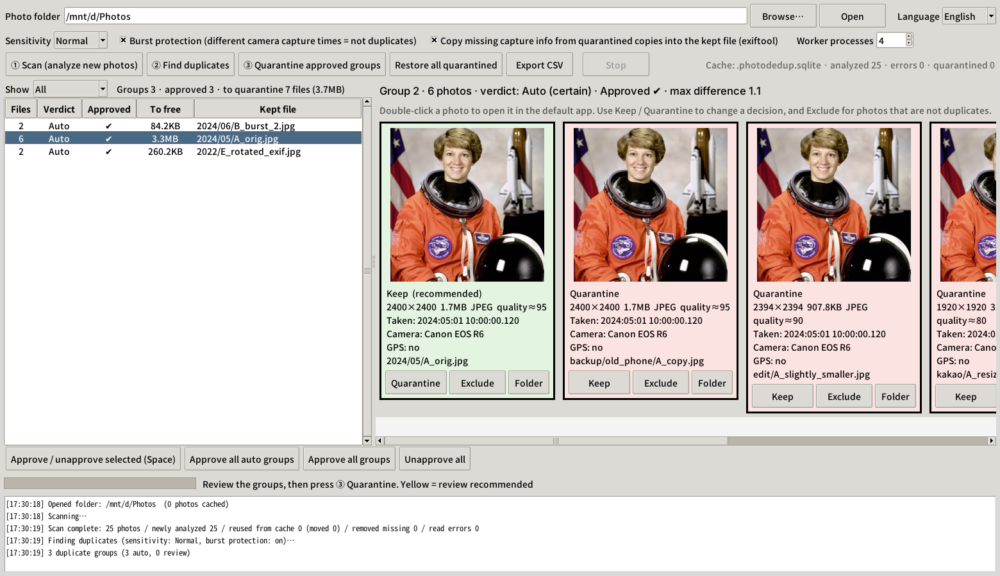
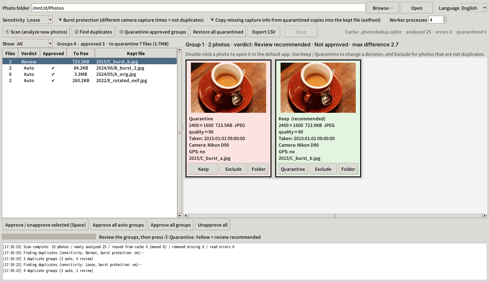
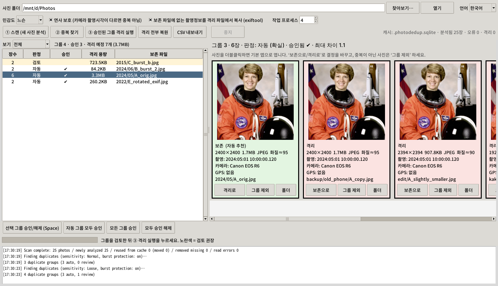

# photo-dedup

Find **near-duplicate photos** in a large photo library, keep the copy with the best quality and metadata, and move the rest to a quarantine folder. Comes with a GUI (tkinter) and a command-line interface, all in a single file (`photo_dedup.py`).

- Groups copies scattered across folders, including recompressed, resized, rotated and metadata-stripped copies.
- Keeps burst shots apart: similar-looking frames with different EXIF capture times (down to the sub-second) are not treated as duplicates.
- Never deletes anything. Duplicates are moved to `_quarantine/` and can be restored at any time.
- Caches analysis results in SQLite, so later runs only analyze photos that are new or have changed.
- English UI by default, with a Korean UI available (`--lang ko`).



## Installation

These steps assume Ubuntu on WSL (Windows). The GUI is shown on the Windows desktop through WSLg, which needs Windows 11 or an up-to-date WSL.

```bash
sudo apt install python3-tk python3-pip libimage-exiftool-perl
pip install --break-system-packages -r requirements.txt
```

| Package | Purpose |
|---|---|
| `numpy`, `pillow` | Required |
| `pillow-heif` | Optional. HEIC/HEIF support |
| `python3-tk` | GUI |
| `exiftool` | Optional. Copying capture info into kept files |
| `fonts-noto-cjk` | Optional. Needed for the Korean UI and for Korean file names. Without it, Korean text shows up as boxes |

Any other Linux with Python 3.10+ and Tk should work as well.

## Usage

### GUI

```bash
python3 photo_dedup.py gui /mnt/d/Photos
```

The screenshot at the top of this page shows the result of steps 1 and 2 on a sample library:

- The list on the left shows one row per duplicate group, with its verdict, whether it is approved, how much space it frees, and the file that will be kept.
- The selected group contains six copies of the same photo found in different folders: the original, an exact copy in a backup folder, a copy resized and recompressed by a messenger app, a copy with all metadata stripped, a copy whose date was typed in manually in Windows Explorer, and a copy that is a few pixels smaller.
- Each card shows the resolution, file size, estimated JPEG quality, capture time, camera and path. The original is recommended as the keeper because it has the highest resolution, the original camera EXIF and the best quality.

Steps:

1. **① Scan** analyzes every photo and stores the results in `<photo folder>/.photodedup.sqlite`. The first scan of a large library takes a while. Results are saved as it goes, so it can be stopped and resumed.
2. **② Find duplicates** builds the duplicate groups. Green cards are kept, red cards will be quarantined.
3. **Review** the groups. Yellow rows are groups marked *Review*. Press Space to approve a group and move to the next one. You can change which file is kept, or *Exclude* a photo that is not a duplicate. These decisions are remembered across runs.

   In the example below, two frames from an older camera were taken in the same second, and the camera did not record sub-seconds. They look almost identical, so the program cannot tell a burst from a copy. The group is marked *Review* and is not approved automatically. If they are two different frames, press *Exclude* on one of them.

   

4. **③ Quarantine** moves the files marked for quarantine in approved groups to `_quarantine/<original relative path>`. Sidecar files with the same name (`.AAE`, `.XMP`) are moved along with them.
5. Once you have checked the result, delete the `_quarantine` folder yourself, or use **Restore all quarantined** to undo.

### Command line

```bash
python3 photo_dedup.py scan /mnt/d/Photos -j 6
python3 photo_dedup.py find /mnt/d/Photos --csv groups.csv [--preset strict|normal|loose]
python3 photo_dedup.py quarantine /mnt/d/Photos [--include-review] [--copy-meta]
python3 photo_dedup.py restore /mnt/d/Photos
```

By default, `quarantine` only processes *Auto* groups. Add `--include-review` to process *Review* groups as well.

### Language

The UI is in English by default. To use Korean, do one of the following:

- Pass `--lang ko` on the command line, for example `python3 photo_dedup.py --lang ko gui`.
- Set the environment variable `PHOTODEDUP_LANG=ko`.
- Choose the language from the selector in the GUI. The switch is immediate and is remembered in `~/.config/photodedup/settings.json`.



## How it works

1. **Indexing.** For each photo, the scan records the resolution, the estimated JPEG quality (from the quantization tables), EXIF data (capture time with sub-seconds, camera, GPS), a perceptual hash (pHash) and a 64×64 grayscale thumbnail. JPEGs are decoded with DCT-domain downscaling, which keeps the scan fast. A file whose path, size and modification time are unchanged is not read again. A file moved to another folder is recognized by its name, size and modification time.
2. **Candidate search.** Pairs with a small pHash Hamming distance become candidates. Pairs whose aspect ratios differ by more than 3% (crops) are discarded.
3. **Verification.** Each candidate pair is confirmed by comparing the thumbnails directly, using the mean absolute difference and the correlation.
4. **Burst protection.** If both photos carry original camera EXIF and their capture times differ, they are never grouped together. The rule also applies when groups are merged: every pair inside a group must satisfy it.
5. **Choosing the keeper.** The order of preference is resolution (within 3% counts as equal), then metadata (camera EXIF, capture time, GPS), then JPEG quality, then file size. Metadata comes before the quality estimate because the estimate only reflects the encoder settings. A re-saved copy often reports a higher setting than the original even though it has already lost detail, while the original usually still carries its camera EXIF.
6. **Verdict.** A group is marked *Auto* when its copies share the exact capture time down to the sub-second, or when their thumbnails are virtually identical. Everything else is marked *Review*. Photos taken in the same second by a camera that does not record sub-seconds may be burst frames, so they are always marked *Review*.

### Sensitivity

| Preset | When to use it |
|---|---|
| Strict | Burst frames or similar shots are being grouped by mistake |
| Normal | Default |
| Loose | Copies are being missed, for example copies that were enhanced or sharpened |

### Copying capture info

If the kept file (for example a full-resolution copy) has no capture info but a quarantined copy does, `exiftool` can copy the capture time, camera and GPS data into the kept file. The original kept file is backed up to `_quarantine/_meta_backup/` first. Turn this on in the GUI or with `--copy-meta`.

## Notes

- With 60,000 photos, the comparison step takes about 30 seconds and the cache is about 200 MB. Scan time depends mostly on disk read speed. When reading from `/mnt/d` in WSL, 4 to 6 worker processes is a good setting.
- Supported formats: JPEG, PNG, WebP, TIFF, BMP, and HEIC/HEIF (requires `pillow-heif`). Live Photo `.MOV` files and RAW files are left untouched.
- The first time you use it, open a few *Auto* groups and check the results yourself.

## Screenshots

The screenshots were taken on a test library generated from the sample images bundled with [scikit-image](https://scikit-image.org/).

## License

[Apache License 2.0](LICENSE)
